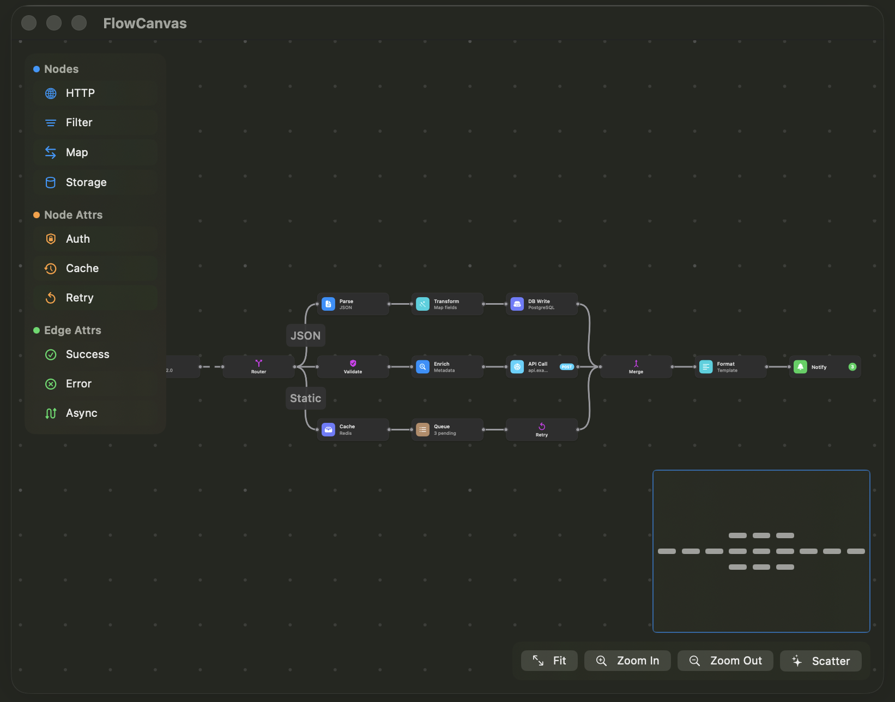

# SwiftFlow

A Canvas-based flow diagram library for SwiftUI, supporting iOS and macOS.



Edges are batch-drawn via `GraphicsContext` for performance. Nodes are rendered as SwiftUI views via `resolveSymbol`, so you can use any SwiftUI view as a node.

## Requirements

- Swift 6.2+
- iOS 26+ / macOS 26+

## Installation

```swift
dependencies: [
    .package(url: "https://github.com/1amageek/swift-flow.git", from: "0.22.1")
]
```

## Quick Start

```swift
import SwiftUI
import SwiftFlow

struct ContentView: View {
    @State var store = FlowStore<String>(
        nodes: [
            FlowNode(id: "a", position: CGPoint(x: 50, y: 100), size: CGSize(width: 120, height: 50), data: "Start"),
            FlowNode(id: "b", position: CGPoint(x: 250, y: 100), size: CGSize(width: 120, height: 50), data: "End"),
        ],
        edges: [
            FlowEdge(id: "e1", sourceNodeID: "a", sourceHandleID: "source", targetNodeID: "b", targetHandleID: "target"),
        ]
    )

    var body: some View {
        FlowCanvas(store: store)
    }
}
```

This renders two nodes connected by a bezier edge. Nodes are draggable, the canvas supports pan and zoom out of the box.

## Core Concepts

### FlowStore

`FlowStore<Data>` is the single source of truth. It is `@Observable` and `@MainActor`.

The generic parameter `Data` is the payload each node carries. It must conform to `Sendable & Hashable` (add `Codable` for serialization).

```swift
// Initialize with nodes and edges
let store = FlowStore<String>(
    nodes: [node1, node2],
    edges: [edge1],
    configuration: FlowConfiguration(
        defaultEdgePathType: .smoothStep,
        snapToGrid: true,
        gridSize: 20
    )
)
```

### FlowNode

Each node has a position, size, and custom data payload.

```swift
FlowNode(
    id: "node-1",
    position: CGPoint(x: 100, y: 200),
    size: CGSize(width: 150, height: 60),     // default: 150x60
    data: "My Node",
    isDraggable: true,                         // default: true
    zIndex: 0,                                 // default: 0
    handles: [                                 // default: target(top), source(bottom)
        HandleDeclaration(id: "in", type: .target, position: .left),
        HandleDeclaration(id: "out", type: .source, position: .right),
    ]
)
```

#### Handles

Handles are connection points on a node. Each handle has an `id`, a `type` (.source or .target), and a `position` (.center, .top, .bottom, .left, .right).

- `.source` handles can connect **to** `.target` handles
- `.target` handles can receive connections **from** `.source` handles

Default handles are `target` at top and `source` at bottom (vertical flow). Override for horizontal layouts:

```swift
let horizontalHandles = [
    HandleDeclaration(id: "target", type: .target, position: .left),
    HandleDeclaration(id: "source", type: .source, position: .right),
]
```

Connection hit areas are independent from the edge endpoint position. This lets an app keep the edge endpoint at the node center while accepting drops across the whole node, or start connections only from a narrow border band:

```swift
let nodeWideHandles = [
    HandleDeclaration(
        id: "source",
        type: .source,
        position: .center,
        connectionStartArea: .nodeBorder(width: 6),
        connectionTargetArea: .disabled
    ),
    HandleDeclaration(
        id: "target",
        type: .target,
        position: .center,
        connectionStartArea: .disabled,
        connectionTargetArea: .node
    ),
]
```

A node can have multiple handles:

```swift
let multiHandles = [
    HandleDeclaration(id: "in", type: .target, position: .left),
    HandleDeclaration(id: "out-yes", type: .source, position: .right),
    HandleDeclaration(id: "out-no", type: .source, position: .bottom),
]
```

### FlowEdge

Edges connect a source handle on one node to a target handle on another node.

```swift
FlowEdge(
    id: "edge-1",
    sourceNodeID: "node-1",
    sourceHandleID: "out",        // matches HandleDeclaration.id on source node
    targetNodeID: "node-2",
    targetHandleID: "in",         // matches HandleDeclaration.id on target node
    pathType: .bezier,            // .bezier | .straight | .smoothStep | .simpleBezier
    label: "Yes"                  // optional label displayed on the edge
)
```

Edge animation is managed separately via the store's `animatedEdgeIDs` side-table — see [Edge Animation](#edge-animation).

#### Routed edges

Set `FlowEdge.waypoints` to an ordered list of canvas-space points for a
polyline between the live handle anchors. For a custom cubic path, set
`pathType: .bezier` and supply an `EdgeBezierRoute`. Its source and target
controls are offsets from the live handle anchors. Each `EdgeBezierWaypoint`
is an on-curve point with its own incoming and outgoing control offsets.

An explicit cubic route takes precedence for `.bezier` edges. The store uses
the resolved path for drawing, labels, and hit testing. Call
`store.edgePath(for: edge)` to anchor custom overlays to that same geometry.

### FlowCanvas

The main view. It accepts `@ViewBuilder` closures for customizing node and edge appearance.

```swift
// Default appearance
FlowCanvas(store: store)

// Custom nodes
FlowCanvas(store: store) { node, context in
    MyNodeView(node: node)
}

// Custom nodes + custom edges
FlowCanvas(store: store) { node, context in
    MyNodeView(node: node)
} edgeContent: { edge, geometry in
    geometry.path.stroke(edge.isSelected ? .blue : .gray, lineWidth: 2)
}

// Default nodes + custom edges
FlowCanvas(store: store, edgeContent: { edge, geometry in
    geometry.path.stroke(.red, lineWidth: 2)
})
```

## Custom Node Views

Provide a `@ViewBuilder` closure to `FlowCanvas` that returns any SwiftUI view for each node:

```swift
FlowCanvas(store: store) { node, context in
    VStack(spacing: 4) {
        Text(node.data.title)
            .font(.caption.bold())
        Text(node.data.status)
            .font(.caption2)
            .foregroundStyle(.secondary)
    }
    .padding(8)
    .frame(width: node.size.width, height: node.size.height)
    .background(.background, in: RoundedRectangle(cornerRadius: 8))
    .overlay {
        RoundedRectangle(cornerRadius: 8)
            .strokeBorder(node.isSelected ? .blue : .gray.opacity(0.3))
    }
    .overlay {
        ForEach(node.handles, id: \.id) { handle in
            FlowHandle(handle.id, type: handle.type, position: handle.position)
                .frame(
                    maxWidth: .infinity,
                    maxHeight: .infinity,
                    alignment: handleAlignment(handle.position)
                )
        }
    }
}
```

Key points for custom nodes:
- Set `frame(width: node.size.width, height: node.size.height)` to match the node's declared size
- Use `overlay` with `FlowHandle` views to render connection points at the node edges
- Use `node.isSelected` to show selection state
- Use `node.isHovered` to show hover state (mouse over on macOS, pointer hover on iOS)
- Use `FlowHandle(id, type:, position:)` for each handle in `node.handles`

You can also switch between different node views based on the data:

```swift
FlowCanvas(store: store) { node, context in
    switch node.data {
    case .trigger: TriggerNodeView(node: node)
    case .logic:   LogicNodeView(node: node)
    case .output:  OutputNodeView(node: node)
    }
}
```

## Live Node Views

The default `Canvas` + `resolveSymbol` pipeline rasterizes each node every frame, which is great for pure SwiftUI content but falls apart for `UIViewRepresentable` / `NSViewRepresentable` subtrees — `WKWebView`, `MKMapView`, `AVPlayerView`, SceneKit / RealityKit hosts, etc. Their rendering loops, scroll views, decoders, and input handling require a real SwiftUI view in the tree; a one-shot rasterization leaves them blank, flickering, or frozen on the first frame.

`LiveNode` is a container you declare once inside `nodeContent`. It transparently switches between a **cached snapshot** (drawn by `Canvas` when the node is not interactive) and the **real live view** (hosted in a `ZStack` overlay above the `Canvas` when the node is interactive), from a single call site.

### Basic Usage (SwiftUI-only)

```swift
FlowCanvas(store: store) { node, ctx in
    let inset = FlowHandle.diameter / 2
    LiveNode(node: node) {
        TimelineView(.animation) { tl in
            ClockFace(date: tl.date)
        }
    }
    .padding(inset)
    .overlay { FlowNodeHandles(node: node, context: ctx) }
}
```

`LiveNode` captures posters from the mounted node subtree and normalizes them to the current display scale. It never rebuilds `content` in a second SwiftUI tree. On macOS, the default provider captures the owning app window through ScreenCaptureKit and crops the mounted node's exact screen rect from that image; the full window is never stored in `FlowStore`. ScreenCaptureKit requires Screen Recording access. SwiftFlow checks that access before capture and treats denial as a typed capture failure, so it keeps the live overlay visible instead of storing the black image returned by an unauthorized capture. `LiveNode` sizes itself to `node.size`, so the caller does **not** need to apply a `.frame(...)` matching the node — just compose any handle padding, clipping, shadows, or overlays around it.

Canvas and the live overlay have exclusive drawing ownership. A node without a poster is drawn only by the visible, non-hittable warmup overlay; an idle node with a poster is drawn only by Canvas; interaction and capture handoff are drawn only by the overlay. Capture failure keeps the overlay visible instead of revealing a missing or stale poster. A mounted-window crop is accepted only when its source pixels already meet the canonical physical display density; a zoomed-out crop is never upscaled into a future poster. If an older canonical poster exists, it is retained until a sufficiently detailed replacement is available. During live zoom, SwiftUI's effective rendering scale follows the final screen density while poster storage remains canonical to the physical display scale.

`LiveNode` is a phase dispatcher — its only sizing decision is matching `node.size`. Visual treatment (corner radius, the handle-inset padding that keeps handles on the border from being clipped, background, overlays, etc.) is composed with ordinary SwiftUI modifiers around `LiveNode`. Handle drawing is likewise the caller's responsibility: use `FlowNodeHandles(node:context:)` for the library default look, or compose `FlowHandle` views directly for fully custom handles.

### Native Views (WKWebView / MKMapView / AVPlayerView)

The standard poster path captures the mounted window and works for ordinary SwiftUI/AppKit/UIKit composition when Screen Recording access is available. Native views with their own snapshot API should register a provider from the same mounted instance. In particular, `WKWebView.takeSnapshot`, `MKMapSnapshotter`, and media frame extractors avoid Screen Recording permission and preserve the native renderer's current state. The cached image is normalized to `node.size × displayScale` pixels so its raster density matches the surrounding Canvas symbol instead of introducing a separately oversampled island.

`LiveNodePosterContext` exists for views that choose a native poster source or custom poster timing. The provider must read the already-mounted native instance; it must not recreate the node in a second SwiftUI tree.

| Method on ``LiveNodePosterContext`` | Purpose |
|---|---|
| `write(_:)` | Push an explicitly chosen poster when immediate writes are allowed |
| `registerPosterProvider(_:)` | Install an async provider that `LiveNode` can invoke during poster updates |
| `unregisterPosterProvider()` | Clear the provider from teardown paths |
| `requestPosterUpdate()` | Ask `LiveNode` to run the currently preferred provider. An idle mounted view is not captured while hidden; register a custom provider for idle updates. |

Own the native view normally and register its native snapshot provider from the representable. The complete `WKWebView.takeSnapshot` implementation used by the integration preview is in `FlowCanvasLivePreview.swift`:

```swift
private struct WebNode: View {
    let node: FlowNode<MyData>
    let url: URL

    @State private var webView = WKWebView()

    var body: some View {
        LiveNode(node: node, mount: .persistent) {
            WebRepresentable(webView: webView, url: url)
        } placeholder: {
            ProgressView()
        }
    }
}

private struct WebRepresentable: UIViewRepresentable {
    let webView: WKWebView
    let url: URL

    @Environment(\.liveNodePosterContext) private var posterContext

    func makeUIView(context: Context) -> WKWebView {
        if webView.url == nil { webView.load(URLRequest(url: url)) }
        registerPosterProvider()
        return webView
    }

    func updateUIView(_ webView: WKWebView, context: Context) {
        registerPosterProvider()
    }

    private func registerPosterProvider() {
        posterContext?.registerPosterProvider { @MainActor in
            await WebPosterProvider.snapshot(of: webView)
        }
    }
}
```

When a custom poster source is intentional, register a provider explicitly:

```swift
private struct VideoRepresentable: UIViewRepresentable {
    let playerView: AVPlayerView

    @Environment(\.liveNodePosterContext) private var posterContext

    func makeUIView(context: Context) -> AVPlayerView {
        posterContext?.registerPosterProvider { @MainActor in
            await playerView.currentPosterSnapshot()
        }
        return playerView
    }

    static func dismantleUIView(_ view: AVPlayerView, coordinator: ()) {
        // Clear from the coordinator or owner that stores the context.
    }
}
```

### Mount Policy

`LiveNode` accepts a `mount:` argument that controls whether the overlay row hosting the live subtree is allowed to unmount while the node is not interactive.

| `LiveNodeMountPolicy` | Behavior |
|---|---|
| `.onInteraction` *(default)* | The row mounts only while the interaction predicate is true (or while the first snapshot is being warmed). Once interaction ends, the live subtree leaves the view tree and the Canvas rasterize path takes over. Suitable for SwiftUI-only content whose state can be recreated from inputs; the captured snapshot fills the rasterize gap. |
| `.persistent` | The row stays mounted continuously while the node is present. The interaction predicate only toggles `opacity` and hit-testing — the underlying view never detaches. Required for native views whose renderer, scroll state, or helper process depends on stable view identity, including `WKWebView`, `MKMapView`, `AVPlayerView`, and `PDFView`. |

Native views should generally use `.persistent`: `removeFromSuperview` propagates `viewDidMoveToWindow(nil)` into the platform renderer, remote layer, or helper process. Keeping the same view instance mounted preserves URL / scroll / JS state for `WKWebView`, region and tile-renderer state for `MKMapView`, and playback / document state for media or document views. The overlay still hides the live view and disables hit testing while idle, so the Canvas snapshot remains the visible poster.

The cost of `.persistent` is that the live subtree keeps its renderer alive even when the user is not interacting with it. Leave SwiftUI-only `LiveNode`s on the default `.onInteraction`; use `.persistent` when preserving native view identity is more important than minimizing idle work.

The Poster pattern is unchanged by mount policy: while the node is not interactive the Canvas always draws the stored `FlowNodeSnapshot` regardless of whether the live subtree is mounted underneath. `.persistent` only controls visibility, not whether the snapshot is shown.

### Interaction vs Selection

By default a node becomes live/interactable when it is selected or hovered. This mirrors macOS windows: a window under the pointer can scroll even when it is not the selected/frontmost window. Override the interaction predicate with `.liveNodeInteraction`:

```swift
.liveNodeInteraction { node, store in
    guard store.connectionDraft == nil else { return false }
    return store.selectedNodeIDs.contains(node.id) || store.hoveredNodeID == node.id
}
```

With `mountPolicy: .persistent`, the overlay subtree stays mounted across interaction toggles so `WKWebView` page state, scroll offset, JS execution, and player state all survive when interaction ends — the overlay simply hides via opacity + hit-testing. Apps can pause their own internal loops while the node is hidden by reading the published `\.isFlowNodeInteractive` environment value:

```swift
struct WebViewRepresentable: UIViewRepresentable {
    @Environment(\.isFlowNodeInteractive) private var isInteractive
    let url: URL

    func makeUIView(context: Context) -> WKWebView {
        let view = WKWebView()
        view.load(URLRequest(url: url))
        return view
    }

    func updateUIView(_ view: WKWebView, context: Context) {
        isInteractive ? view.resumeAllMediaPlayback() : view.pauseAllMediaPlayback()
    }
}
```

Selection, focus, and hover are published separately for live content that needs keyboard-target styling or hover-only affordances:

```swift
struct WindowLikeChrome: View {
    @Environment(\.isFlowNodeSelected) private var isSelected
    @Environment(\.isFlowNodeFocused) private var isFocused
    @Environment(\.isFlowNodeHovered) private var isHovered

    var body: some View {
        Header()
            .background(isFocused ? Color.accentColor : Color.secondary.opacity(isHovered ? 0.18 : 0.08))
            .overlay(alignment: .bottom) {
                Rectangle()
                    .frame(height: isSelected ? 2 : 0)
                    .foregroundStyle(Color.accentColor)
            }
    }
}
```

### Node Drag and Hit Testing

Node drag is single-sourced through `FlowStore`'s session API — `beginNodeDrag(_:)` / `updateNodeDrag(translation:)` / `endNodeDrag()`. `FlowCanvas.primaryDragGesture` and the `flowDragHandle(for:in:)` modifier both call into it, so multi-selection moves, zoom normalization, and undo registration behave identically regardless of where the drag originated. What changes between nodes is whether drag events ever *reach* one of those drag sites.

- **Plain (non-LiveNode) rows.** The overlay row is kept hit-test transparent until a snapshot is captured, so pointer events pass straight through to the Canvas. No extra work is required.
- **`LiveNode` with non-interactive content** (e.g. a `TimelineView` driving an animation). The content does not consume drags, but the interactive overlay row is still hit-testable so other gestures could route to it. Mark the live view as pass-through so drags reach the Canvas:

  ```swift
  LiveNode(node: node) {
      TimelineView(.animation) { tl in
          ClockFace(date: tl.date)
      }
  }
  .allowsHitTesting(false)
  ```

- **`LiveNode` with drag-consuming content** (`WKWebView`, `MKMapView`, `AVPlayerView`, or any view containing a `ScrollView` / pan gesture). Drags landing inside the live row are eaten by the inner view and never reach the Canvas, so a Canvas-level pass-through trick will not work. Attach `flowDragHandle(for:in:)` to a dedicated grip — typically a header bar overlaid on top of the live content — and that view dispatches its drag straight into `FlowStore`:

  ```swift
  LiveNode(node: node, mount: .persistent) {
      WebNodeRepresentable(webView: webView, url: url)
  }
  .overlay(alignment: .top) {
      Text(node.data.title)
          .frame(maxWidth: .infinity, alignment: .leading)
          .padding(6)
          .background(.thinMaterial)
          .contentShape(Rectangle())
          .flowDragHandle(for: node, in: store)
  }
  ```

  The drag zone (the header) and the moved node (`node`) are decoupled — the header drags the `LiveNode` underneath without sharing geometry with it, and the `WKWebView` / `MKMapView` body keeps its own scroll / pan / tap handling. Because the modifier funnels through the same `FlowStore` session API as the Canvas's own gesture, multi-selection moves and undo behave identically.

  For the legacy "open a hole and let the Canvas drag through" pattern, `FlowNodeDragHandle { ... }` is still available — it renders `content` with `.allowsHitTesting(false)` so the Canvas's `primaryDragGesture` underneath fires. Use it when the LiveNode body composes a header above the live view inline (rather than as an `.overlay`).

## Custom Edge Views

Provide an `edgeContent` closure to render each edge as a SwiftUI view. The closure receives a `FlowEdge` and an `EdgeGeometry` with pre-computed path and position data in local coordinates.

```swift
FlowCanvas(store: store) { node, context in
    DefaultNodeContent(node: node, context: context)
} edgeContent: { edge, geometry in
    geometry.path.stroke(
        edge.isSelected ? Color.blue : Color.gray,
        style: StrokeStyle(lineWidth: 2, lineCap: .round)
    )
    if let label = edge.label {
        Text(label)
            .font(.caption2)
            .position(geometry.labelPosition)
    }
}
```

### EdgeGeometry

`EdgeGeometry` provides all the information needed to render an edge. All coordinates are in the view's local coordinate system (bounds origin mapped to (0, 0)).

| Property | Type | Description |
|---|---|---|
| `path` | `Path` | Pre-computed edge path |
| `sourcePoint` | `CGPoint` | Source handle position |
| `targetPoint` | `CGPoint` | Target handle position |
| `sourcePosition` | `HandlePosition` | Source handle direction |
| `targetPosition` | `HandlePosition` | Target handle direction |
| `labelPosition` | `CGPoint` | Suggested label placement |
| `labelAngle` | `Angle` | Suggested label rotation |
| `bounds` | `CGRect` | Canvas-space bounding rect |

### Performance Note

When no `edgeContent` closure is provided, edges are batch-drawn via `GraphicsContext` (3 stroke calls for normal, selected, and animated edges). When custom edge content is provided, each edge is rendered as a Canvas symbol. Connection drafts (in-progress connections) always use the efficient `GraphicsContext` path.

## Handling Connections

When a user drags from a source handle to a target handle, `onConnect` is called. You must create the edge yourself:

```swift
store.onConnect = { [weak store] proposal in
    guard let store else { return }
    let edge = FlowEdge(
        id: UUID().uuidString,
        sourceNodeID: proposal.sourceNodeID,
        sourceHandleID: proposal.sourceHandleID,
        targetNodeID: proposal.targetNodeID,
        targetHandleID: proposal.targetHandleID
    )
    store.addEdge(edge)
}
```

### Connection Validation

By default, self-loop connections (same source and target node) are rejected. Provide a custom validator for more rules:

```swift
struct MyValidator: ConnectionValidating {
    func validate(_ proposal: ConnectionProposal) -> Bool {
        // Reject self-loops
        guard proposal.sourceNodeID != proposal.targetNodeID else { return false }
        // Add custom rules here
        return true
    }
}

let config = FlowConfiguration(connectionValidator: MyValidator())
let store = FlowStore<String>(configuration: config)
```

## Observing Changes

React to state changes via callbacks:

```swift
store.onNodesChange = { changes in
    for change in changes {
        switch change {
        case .add(let node):       print("Added: \(node.id)")
        case .remove(let nodeID):  print("Removed: \(nodeID)")
        case .position(let id, let pos): print("Moved \(id) to \(pos)")
        case .select(let id, let selected): print("\(id) selected: \(selected)")
        case .dimensions(let id, let size): print("\(id) resized to \(size)")
        case .replace(let node):   print("Replaced: \(node.id)")
        }
    }
}

store.onEdgesChange = { changes in
    for change in changes {
        switch change {
        case .add(let edge):       print("Connected: \(edge.id)")
        case .remove(let edgeID):  print("Disconnected: \(edgeID)")
        case .select(let id, let selected): print("\(id) selected: \(selected)")
        case .replace(let edge):   print("Updated: \(edge.id)")
        }
    }
}
```

### Double-Tap

Respond to double-tap (double-click) on nodes and edges:

```swift
store.onNodeDoubleTap = { nodeID in
    print("Double-tapped node: \(nodeID)")
}

store.onEdgeDoubleTap = { edgeID in
    print("Double-tapped edge: \(edgeID)")
}
```

Double-tap detection uses manual timing comparison instead of SwiftUI's `onTapGesture(count: 2)`, which would delay single-tap recognition by ~300ms. Single taps always fire immediately; a second tap within 300ms on the same target triggers the double-tap callback.

## FlowConfiguration

All behavior is configurable:

```swift
FlowConfiguration(
    defaultEdgePathType: .bezier,      // .bezier | .straight | .smoothStep | .simpleBezier
    edgeStyle: EdgeStyle(
        strokeColor: .gray,            // normal edge color
        selectedStrokeColor: .blue,    // selected edge color
        lineWidth: 1.5,               // normal width
        selectedLineWidth: 2.5,       // selected width
        dashPattern: [],              // empty = solid line, e.g. [5, 3]
        animatedDashPattern: [5, 5]   // pattern for edges in animatedEdgeIDs
    ),
    backgroundStyle: BackgroundStyle(
        pattern: .grid,                // .none | .grid | .dot
        color: .gray.opacity(0.2),     // line/dot color
        spacing: 20,                   // grid cell size in canvas points
        lineWidth: 0.5,               // grid line width (grid pattern only)
        dotRadius: 1.5                // dot radius (dot pattern only)
    ),
    snapToGrid: false,                 // snap node positions to grid
    gridSize: 20,                      // grid cell size (when snapToGrid is true)
    minZoom: 0.1,                      // minimum zoom level (clamped to >= 0.01)
    maxZoom: 4.0,                      // maximum zoom level (clamped to >= minZoom)
    connectionValidator: nil,          // custom ConnectionValidating, nil = DefaultConnectionValidator
    panEnabled: true,                  // allow canvas panning
    zoomEnabled: true,                 // allow canvas zooming
    selectionEnabled: true,            // allow node/edge selection
    multiSelectionEnabled: true        // allow multi-selection (Shift+drag on macOS, long-press+drag on iOS)
)
```

## Store Operations

### Node Operations

```swift
store.addNode(node)                     // add a node
store.removeNode("node-1")              // remove node and its connected edges
store.moveNode("node-1", to: point)     // move node (respects snapToGrid)
store.updateNode("node-1") { node in   // update any node property in-place
    node.data.badge = "New"
}
store.updateNodeSize("node-1", size: size)  // resize node
```

### Node Drag Session

`FlowCanvas.primaryDragGesture` and the `flowDragHandle(for:in:)` modifier both dispatch through this API, so any drag site you build yourself can join the same code path — multi-selection expansion, zoom-normalized translation, and a single multi-node undo entry are all handled centrally.

```swift
store.beginNodeDrag("node-1")               // capture start positions (expands to selection if applicable)
store.isNodeDragging                        // true while a drag session is in progress
store.updateNodeDrag(translation: t)        // screen-space translation; zoom is applied internally
store.endNodeDrag()                         // commit & register a single undo entry
store.cancelNodeDrag()                      // drop the session without registering undo
```

### Focus and Active Interaction

SwiftFlow keeps persistent selection, keyboard focus, pointer hover, and short-lived interaction ownership separate:

```swift
store.selectedNodeIDs                       // persistent edit selection
store.hoveredNodeID                         // pointer-derived hover
store.focusedTarget                         // keyboard routing target
store.activeInteraction                     // current drag/connect/resize/edit owner
```

### Edge Operations

```swift
store.addEdge(edge)                     // add an edge (rejects duplicate IDs and dangling node references)
store.removeEdge("edge-1")              // remove an edge
store.updateEdge("edge-1") { edge in   // update structural properties (registers undo)
    edge.pathType = .smoothStep
    edge.label = "Updated"
}
store.updateEdges { edge in                // batch update (single undo entry)
    edge.pathType = .straight
}
```

### Selection

```swift
store.selectNode("node-1")              // select (clears other selections)
store.selectNode("node-2", exclusive: false)  // add to selection
store.deselectNode("node-1")
store.selectEdge("edge-1")
store.deselectEdge("edge-1")
store.clearSelection()
```

### Drop Target State

```swift
store.dropTargetNodeID                  // currently highlighted drop target node (nil if none)
store.dropTargetEdgeID                  // currently highlighted drop target edge (nil if none)
store.setDropTargetNode("node-1")       // manually set drop target (usually managed by dropDestination)
store.setDropTargetEdge("edge-1")       // manually set drop target edge
```

### Edge Animation

Animation state is managed as a store-level side-table (`animatedEdgeIDs`), separate from the `FlowEdge` struct. This follows the same pattern as `selectedEdgeIDs` — transient view state lives in the store, not on the model. Animated edges render with a moving dash pattern.

```swift
store.setEdgeAnimated("edge-1", true)       // mark a single edge as animated
store.setEdgeAnimated("edge-1", false)      // stop animating a single edge
store.setAnimatedEdges(["e1", "e2"])        // replace the full animated set
store.setAnimatedEdges([])                  // stop all edge animations
store.animatedEdgeIDs                       // read current animated edge IDs
```

Animation state does not participate in undo/redo and is cleared on `load()`.

### Viewport

```swift
store.pan(by: CGSize(width: 10, height: 0))  // pan canvas
store.zoom(by: 1.5, anchor: center)           // zoom around anchor point
store.fitToContent(canvasSize: size)           // fit all nodes in view
```

### Undo / Redo

Assign an `UndoManager` to enable undo/redo for node add/remove, edge add/remove/update, node move, and selection deletion:

```swift
store.undoManager = undoManager
```

### Queries

```swift
store.edgesForNode("node-1")            // all edges connected to node
store.nodeBounds()                      // bounding rect of all nodes
store.nodeLookup["node-1"]              // O(1) node access by id
store.connectionLookup["node-1"]        // O(1) edges for a node
store.selectedNodeIDs                   // currently selected node IDs
store.selectedEdgeIDs                   // currently selected edge IDs
store.animatedEdgeIDs                   // currently animated edge IDs
store.hoveredNodeID                     // currently hovered node ID (nil if none)
store.dropTargetNodeID                  // currently highlighted drop target node
store.dropTargetEdgeID                  // currently highlighted drop target edge
```

## Serialization

Export and import the entire diagram as JSON (requires `Data: Codable`):

```swift
// Export
let document = store.export()
let jsonData = try document.encoded()

// Import
let document = try FlowDocument<String>.decoded(from: jsonData)
store.load(document)
```

`FlowDocument` contains nodes, edges, and viewport state. Selection state is cleared on export.

## Drop Destination

Enable drag-and-drop onto the canvas, nodes, and edges using the `dropDestination(for:action:)` modifier.

```swift
FlowCanvas(store: store) { node, context in
    MyNodeView(node: node)
}
.dropDestination(for: [UTType.json]) { phase in
    switch phase {
    case .updated(let providers, let location, let target):
        // Called continuously during drag hover.
        // `target` tells you what's under the cursor:
        //   .canvas        — empty area
        //   .node(nodeID)  — over a node
        //   .edge(edgeID)  — over an edge
        // Return true to accept (highlights the target), false to reject.
        return true

    case .performed(let providers, let location, let target):
        // Drop occurred. Decode providers and act based on target.
        for provider in providers {
            provider.loadDataRepresentation(forTypeIdentifier: UTType.json.identifier) { data, error in
                guard let data else { return }
                // decode and handle...
            }
        }
        return true

    case .exited:
        return false
    }
}
```

### DropPhase

| Case | Parameters | Description |
|---|---|---|
| `.updated` | `[NSItemProvider], CGPoint, DropTarget` | Drag hovering — return `true` to highlight target |
| `.performed` | `[NSItemProvider], CGPoint, DropTarget` | Drop completed — decode and apply |
| `.exited` | — | Drag left the canvas |

### DropTarget

| Case | Value | Description |
|---|---|---|
| `.node` | `String` (node ID) | Cursor is over a node |
| `.edge` | `String` (edge ID) | Cursor is over an edge |
| `.canvas` | — | Cursor is over the background |

### Drop Target Visual Feedback

Nodes and edges have an `isDropTarget: Bool` property that the library manages automatically based on the `Bool` you return from `.updated`. Use this in custom node views:

```swift
FlowCanvas(store: store) { node, context in
    RoundedRectangle(cornerRadius: 8)
        .fill(node.isDropTarget ? Color.accentColor.opacity(0.1) : Color(.systemBackground))
        .overlay {
            RoundedRectangle(cornerRadius: 8)
                .strokeBorder(node.isDropTarget ? Color.accentColor : .gray, lineWidth: node.isDropTarget ? 2 : 0.5)
        }
        .scaleEffect(node.isDropTarget ? 1.04 : 1.0)
        .animation(.spring(duration: 0.2), value: node.isDropTarget)
}
```

Drop-target edges are drawn with an accent-colored stroke automatically by the built-in edge renderer. The store also exposes `dropTargetNodeID` and `dropTargetEdgeID` for reading the current target.

## Canvas Overlay

Use `.canvasOverlay { ... }` for interactive content positioned in Canvas-local
screen coordinates, such as connection-label buttons. Content is hosted inside
the platform event host, above the batch Canvas and below live nodes and selection
accessories. On macOS, unconsumed wheel events reach the existing Canvas viewport
handler. Controls that consume scrolling keep their own behavior. An ordinary
outer SwiftUI `.overlay` sits outside that host's responder chain.

## Accessory Views

Attach floating views near selected nodes or edges. Accessory views appear/disappear with animation when selection changes.

### Node Accessory

```swift
FlowCanvas(store: store) { node, context in
    MyNodeView(node: node)
}
.nodeAccessory { node in
    VStack {
        Text(node.data.title).font(.headline)
        Button("Delete") { store.removeNode(node.id) }
    }
    .padding(8)
    .background(.regularMaterial, in: RoundedRectangle(cornerRadius: 8))
}
```

With per-node placement:

```swift
.nodeAccessory(placement: { node in
    node.data.category == "trigger" ? .bottom : .top
}) { node in
    MyAccessoryView(node: node)
}
```

### Edge Accessory

```swift
.edgeAccessory { edge in
    HStack {
        Text(edge.label ?? "Edge")
        Button(role: .destructive) { store.removeEdge(edge.id) } label: {
            Image(systemName: "xmark.circle.fill")
        }
    }
    .padding(6)
    .background(.regularMaterial, in: Capsule())
}
```

### Placement Options

| `AccessoryPlacement` | Description |
|---|---|
| `.top` | Above the node/edge midpoint (default) |
| `.bottom` | Below |
| `.leading` | Left side |
| `.trailing` | Right side |

The library flips placement automatically when the accessory would be clipped by the canvas edge.

## Interaction Reference

| Action | macOS | iOS |
|---|---|---|
| Drag node | Drag on node | Drag on node |
| Pan canvas | Scroll / drag on empty area | Drag on empty area |
| Zoom | Pinch trackpad / scroll+magnify | Pinch gesture |
| Connect | Drag from handle to handle | Drag from handle to handle |
| Select node/edge | Click | Tap |
| Double-tap node/edge | Double-click | Double-tap |
| Add to selection | Command + Click | Command + Tap |
| Multi-select (rect) | Shift + drag rectangle | Long press + drag |
| Hover | Mouse over node | Pointer hover |
| Cursor feedback | Contextual (hand/crosshair/arrow) | N/A |
| Drop onto canvas | Drag external item onto canvas | Drag external item onto canvas |

## Layout Algorithms

SwiftFlow exposes layout as a protocol, not a fixed policy. Apps can keep
layout conservative for a canvas tool, or plug in stronger algorithms for
workflow graphs, compound groups, or graph exploration.

```text
FlowStore snapshot
      ↓
FlowLayoutContext<Data>
      ↓
FlowLayoutAlgorithm
      ↓
FlowLayoutResult.positions
      ↓
FlowStore.applyLayout(...)
```

| Type | Role |
|---|---|
| `FlowLayoutAlgorithm` | Strategy protocol implemented by overlap-removal, layered, force-directed, or app-specific algorithms |
| `FlowLayoutContext` | Immutable graph snapshot with nodes, edges, selection, scope, and options |
| `FlowLayoutScope` | Limits layout to all nodes, selected nodes, explicit IDs, descendants, or children of a group |
| `FlowLayoutOptions` | Shared knobs such as spacing, padding, locked nodes, and whether to preserve relative positions |
| `FlowLayoutResult` | Position updates returned by the algorithm |

Example:

```swift
struct TidyLayout<Data: Sendable & Hashable>: FlowLayoutAlgorithm {
    func layout(context: FlowLayoutContext<Data>) throws -> FlowLayoutResult {
        var positions: [String: CGPoint] = [:]
        for node in context.scopedNodes {
            positions[node.id] = node.position
            // Apply app-specific overlap removal / alignment here.
        }
        return FlowLayoutResult(positions: positions)
    }
}

try store.layout(
    using: TidyLayout<String>(),
    scope: .selected,
    options: FlowLayoutOptions(lockedNodeIDs: ["anchor"]),
    animation: .smooth
)
```

## Architecture

```
┌─────────────────────────────────────────────┐
│ FlowCanvas<NodeData, NodeView>              │
│  ├─ Canvas + GraphicsContext (edges)        │
│  ├─ resolveSymbol (nodes as SwiftUI Views)  │
│  ├─ LiveNodeOverlay (ZStack, native views)  │
│  ├─ @ViewBuilder nodeContent closure        │
│  ├─ @ViewBuilder edgeContent closure (opt)  │
│  └─ Gesture state machine                   │
├─────────────────────────────────────────────┤
│ FlowStore<Data>  (@Observable, @MainActor)  │
│  ├─ nodes: [FlowNode<Data>]                │
│  ├─ edges: [FlowEdge]                      │
│  ├─ viewport: Viewport                      │
│  ├─ selectedNodeIDs / selectedEdgeIDs      │
│  ├─ animatedEdgeIDs (side-table)           │
│  ├─ nodeSnapshots (rasterize cache)         │
│  ├─ nodeLookup / connectionLookup (O(1))   │
│  └─ hit testing, connection workflow        │
├─────────────────────────────────────────────┤
│ Protocols                                    │
│  ├─ EdgePathCalculating (custom routing)    │
│  └─ ConnectionValidating (connection rules) │
└─────────────────────────────────────────────┘
```

## License

MIT License. See [LICENSE](LICENSE) for details.
